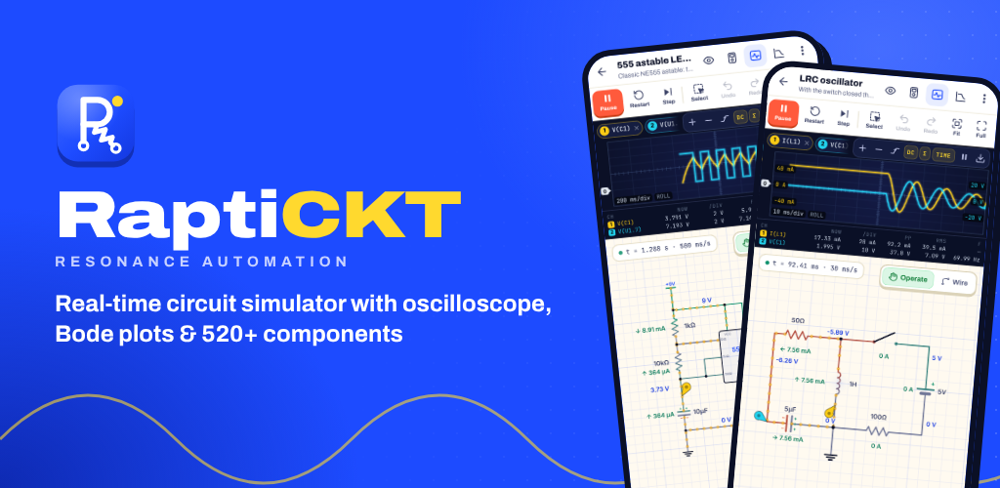

# RaptiCKT — Resonance Automation Circuit Simulator

<p align="center"></p>

RaptiCKT is a real-time analog / digital / mixed-signal circuit simulator for Android. It is built for electrical & electronic engineering students and researchers, and made by **RAPTI — Resonance Automation Professional Training Institute** ([rapti.net](https://rapti.net)).

It combines the best of EveryCircuit and VoltSim: an unlimited schematic canvas, live voltage/current animation, a rotary value knob, oscilloscope and multimeter. On top of that it adds research features: Bode plots, DC sweeps, operating-point tables, SPICE netlist export and a verified SPICE-class engine.

## Download the APK

Every push is built by GitHub Actions (`.github/workflows/android.yml`), which publishes a signed APK as a **GitHub Release**:

1. Open the repository's **Releases** page and pick the newest `RaptiCKT v1.0.0 (build N)`.
2. Download `RaptiCKT-v1.0.0-buildN.apk` (or `RaptiCKT-latest.apk`) on your phone.
3. Open it, and allow "Install unknown apps" for your browser or file manager if Android asks. Requires Android 8.0 or newer.

## Features

- **521 components** in 22 categories, each with a physical simulation model:
  - Sources (35): DC/AC/pulse/triangle/saw/noise/chirp, AM/FM, PWM, step, ramp, exponential, damped sine, PWL, f(t) expression, single-phase mains presets, 3-phase star/delta supply, bench PSU (CV/CC), dual PSU, PV module, rails, net labels, controlled sources (including the textbook diamond), earth/chassis
  - Batteries (16): AA, 9 V, coin cell, NiMH, NiCd, Li-ion, 2S Li-Po, LiFePO₄ cell and 12.8 V battery, lead-acid, AGM, gel, configurable S/P pack, supercapacitor, BMS protection board, CC-CV charger — all with state-of-charge models that collapse when exhausted
  - Renewables (7): PV array, MPPT and PWM solar charge controllers, off-grid and grid-tie (anti-islanding) inverters, wind turbine, PEM fuel cell
  - Passive (25): R, shunt, fusible resistor, pots, rheostat, C (electrolytic, non-polar, tantalum, MLCC, film, PET, PP, silver-mica, variable, ESR/ESL model), L (variable, saturating iron core), ferrite bead, crystal, ceramic resonator, transmission line, memristor
  - Transformers (11): single-phase, centre-tapped, dual secondary, isolation, step-down/up, autotransformer (variac), 3-phase Dyn11/Yyn0/Yd1/Dd0, CT, PT, coupled inductors
  - Protection (24): fuse, HRC fuse, thermal fuse, PTC polyfuse, MCB 1P/2P/3P (B/C/D curves), MCCB, ACB (LSI), RCCB, RCBO, overload relays (1- and 3-pole), phase-failure/sequence and over/under-voltage relays, IDMT relay, MOV, arrester, GDT, TVS, and ladder-diagram overload heaters, phase monitor and MPCB
  - Switches & Relays (52): house-wiring switches, toggle/slide/rocker/key/DIP/foot switches, push buttons, emergency stop, limit, reed, float, pressure, thermostat, isolator, changeover, voltage/current-controlled switches, relays (SPST/DPST/DPDT, reed, latching, control relay 2NO+2NC), contactors with auxiliary contacts, timer relay, SSR, and ladder-diagram parts (contactor coil, ON/OFF/twin timer coil, counter and counter-reset coils, floatless level relay, NO and NC contacts, 3-pole main contacts, limit switches, a moving carriage / pneumatic cylinder and a water tank) whose contacts follow the coil with the same tag
  - Electrical (23): incandescent, halogen, CFL, LED bulb, LED strip/panel/driver, tube light with choke and starter, neon, fan, heater, socket + appliance, dimmer, fan regulators, bell, earth electrode, photocell and PIR light switches, emergency light
  - Power Systems (14): rated R/L/C and 3-phase loads, PF-correction capacitor, short and π lines, single-core (IEC 60228 / 60364-5-52, RE/RM/SM/RF, Cu/Al, PVC/XLPE) and 2- and 4-core cables that heat and can burn (resistance from length, size, copper/aluminium), busbar (2–24 taps, standard copper bar sizes or any cross-section), junction box, timed fault
  - Machines (16): DC motors (PM, separately excited, shunt, series, compound, universal), DC generator, 3-phase induction motor (3- and 6-terminal for star-delta), capacitor motor, synchronous motor, PMSM, BLDC with Hall sensors, stepper, alternators
  - Diodes, Transistors (30): tunnel, CRD, varactor, bridge and 3-phase rectifiers, BJTs, MOSFETs, JFETs, Darlington, IGBT, depletion MOSFET, UJT, optocoupler and more
  - Thyristors & Power (30): SCR, TRIAC, DIAC, SIDAC, SCS, LASCR, GTO, IGCT, PUT, opto-TRIAC/SCR, gate driver, IGBT half-bridge and IPM, H-bridge and 3-phase inverter bridges, SPWM (V/f) modulator, BLDC and stepper drivers, SCR firing unit, buck/boost/buck-boost/Ćuk/SEPIC/flyback/forward/push-pull/half- and full-bridge converters
  - Analog ICs (27): op-amps, buffer, differential/transimpedance/instrumentation amps, TDA2030, comparators (incl. open collector), OTA, LM386, AD633, 555/556, PLL, 78xx/79xx, LM317/337, LDO, TL431, LM4040, ICL7660, CD4066, sample & hold, VCO, true-RMS converter
  - Control & Math (22): gain, sum, multiply, divide, limiter, abs, sqrt, power, log, exp, trig, f(u,v), integrator, differentiator, transfer functions, PID, delay, ZOH, rate limiter, relay
  - Logic Gates and Digital ICs (66): gates, tri-state, adders, comparator, mux, decoders, encoder, parity, latches, flip-flops, shift registers (incl. 74HC595), counters, register, clock divider, monostable, ADC, DAC and more
  - Communication (18): UART TX/terminal, RS-232, RS-485, CAN, SPI and I²C masters, PCF8574 expander, wireless link with link budget (433 MHz, nRF24L01, BLE, Wi-Fi, LoRa, Zigbee), RFID reader, fibre link, antenna, RF amp, mixer, envelope detector, active and SAW filters, EMI filter — behavioural blocks, no firmware or user code is executed
  - Sensors (58): light, temperature, strain/load/force, Hall, current, voltage, accelerometer, gyro, IMU, magnetometer, PIR, IR, ultrasonic (incl. HC-SR04), gas, CO₂, smoke, humidity, soil, rain, water level, pressure, flame, UV, wind, flow, encoders, inductive/capacitive proximity, photo-eye, 4–20 mA transmitters and more
  - Output (23): LEDs (RGB, bicolour, IR, laser), 7- and 14-segment, dot matrix, hex display, bar graph, buzzers, speaker, headphone, preamp, tone control, equaliser, solenoid, servo, Peltier, DC fan, electromagnet
  - Vacuum Tubes (3) and Meters (21): voltmeter, ammeter, ohmmeter, wattmeter, true-RMS meters, frequency, phase, power-factor, VAR, kWh, dB, peak, LCR, megger, panel meter, moving-coil meters, test point
- **Real-life limits — parts burn, wires catch fire**:
  - Over-stressed parts are destroyed and stay that way (also after Restart) until you select them and tap **Replace**: a bulb on 1.6 × its voltage (230 V bulb on 400 V), an LED without a resistor, a resistor above its power rating (1/8 W … 100 W), an electrolytic capacitor over-voltaged or reversed (a tantalum fails short), a fan / heater / LED bulb on too high a voltage, an RCCB overloaded without an MCB, an MCB / MCCB / RCBO whose fault current exceeds its breaking capacity Icn. Fuses stay blown until replaced. Each failure shows a flash, flames and smoke, a bang and a message saying why.
  - Every drawn wire is a real cable: choose house wire (BYA / H07V), flexible cord, rubber cable or NYY / N2XY / NAYY / NA2XY power cable, 0.5–400 mm², **RE / RM / SM / RF** conductor (IEC 60228) and the installation method (A1, B1, C, E, D). Its current rating Iz follows IEC 60364-5-52; a conductor-temperature model (calibrated to the rated temperature at Iz and the adiabatic I²t = k²S² limit) makes an overloaded wire glow, smoke, catch fire and burn through, opening the circuit. **⋮ → Replace burnt parts & wires** repairs everything at once.
  - Breaker trips, relay timing, cable heating and burning run on the **real-time clock** while the waveforms are shown slowed down, so an MCB at 2.5 × In trips after about 20 real seconds, like a real one (Settings → *Heating & trip timing*: real time, 10× faster or simulation time; *Parts burn out* switches damage off; *New wires* sets the default cable).
- **AC readings like a real meter**: in circuits with a sinusoidal supply (mains, AC sources, 3-phase), live labels show the RMS over one supply cycle (e.g. `12 V~` on a 230 V : 12-0-12 V transformer) and DC nets show their average. Voltmeters and ammeters default to *Auto* (RMS in AC circuits). Switch to instantaneous values in Settings → AC readings.
- **Live readings on the schematic**: while the simulation runs, every net shows its voltage (blue) and every two-terminal part shows its current with a direction arrow (green), placed so they never overlap one another, a part or a text label (when a crowded net has no free spot, its reading is left out; a probe still reads it). Value labels step further out when the spot next to their part is taken. Both can be switched off in Settings.
- **Oscilloscope**: 6 channels on a real 10 × 8 graticule with one shared 1-2-5 V/div scale and 0 V line for all voltage channels (currents on their own A/div with 0 A on the same line), 1-2-5 time/div, CH1 edge trigger (off by default; turn it on for a steady picture), ground markers, a touch cursor read-out, frequency/RMS/p-p, FFT spectrum, XY mode, AC/DC input coupling, timing measurements (mean, duty cycle, rise/fall time, phase) and CSV export.
- **Multimeter**: draggable probes for V (DC + true RMS), A, Ω (small-signal, with continuity), W, Hz and LC (capacitance / inductance at 1 kHz).
- **Analyses**:
  - AC sweep (Bode) with automatic −3 dB, f₀, bandwidth, Q and phase margin
  - DC sweep
  - Operating point
  - Harmonics (Fourier series, THD, crest factor)
  - Impedance vs frequency
  - Parametric sweep (families of transient curves)
  - Monte Carlo tolerance analysis
  - Power / efficiency table
  - SPICE netlist
- **Circuit from photo** (**⋮ → Circuit from photo** in the editor, or the button on an empty board): take a photo of a circuit diagram — a textbook figure, an exam question, a sketch — or choose a picture, crop it to the circuit, and it is read into a circuit on the board with its values, dependent sources (the textbook diamonds such as 0.1vₓ or 4iₓ) and marked voltages and currents, ready to run. A page with several figures lists them to pick from. A part read wrong is put right in the list under the drawing (its kind, its value, or remove it) before the circuit opens on the board, paused, its values written big; a reading is not always 100 % right, so it says to check it against the picture and fix it. Hand-drawn sketches are read too, also on ruled or squared paper and from photos taken a little turned, with AC sources, coils drawn as loops and open switches; so are bridges drawn as a diamond and deltas and stars drawn as triangles (drawn slanting on the board too, at the angle they were drawn, each side drawn straight coming out straight, joined as drawn, their values read also when printed along the slanting sides), small resistors whose zigzag ran together in the photo, op amps (placed as the ideal op amp, − and + as drawn), values printed as fractions (½ H, ¼ F), conductances in siemens, mesh-current arrows (left out), and whole textbook pages with coloured headings, shaded boxes and meters beside the circuits. Read on the phone itself: offline, no account or key, the picture never leaves the phone.
  - A vision pipeline in plain JavaScript (`web/src/vision/`) binarizes the picture, thins the line drawing into a graph of wires and joints, finds the parts (zigzags, coils, plates, circles and diamonds with their + / − or arrow, grounds), reads the labels with two small character classifiers — one trained on rendered textbook fonts, one also on hand-writing made from pen strokes in many hands (`web/tools/glyphs/`: `render.py`, `hand.py`, `train.py`) — decides for each figure whether its labels are printed or hand-written, ties values, expressions and marked quantities to their parts, and lays the circuit out on the grid. Made for printed diagrams (textbooks, exam papers, screenshots) and neat hand sketches; its tests read textbook-style and hand-drawn figures made by `web/tools/glyphs/figures.py`.
- **Load Flow Analysis** (its own section: the card on Home or **⋮ → Load flow analysis**): power-system power flow on bus / branch data
  - Newton–Raphson (polar), Gauss–Seidel (with acceleration factor), Fast Decoupled (XB) and DC load flow, with generator Q limits (PV → PQ switching), flat start, tolerance and iteration settings
  - Test systems: Saadat 3-bus (GS and NR examples), Stagg & El-Abiad 5-bus, Wood & Wollenberg 6-bus, WSCC 9-bus, IEEE 14-bus, plus a template for your own; add / edit buses, lines and tap / phase-shifting transformers, save them, and import / export MATPOWER case files
  - Results: bus voltages and angles, generation, line flows at both ends, losses, line charging, loading %, voltage and overload violations; CSV and text report
  - One-line diagram coloured by voltage and loading with flow arrows, charts (voltage / angle profile, convergence, loading, losses), the iteration log and Newton–Raphson Jacobian, the Y-bus matrix, N-1 contingency screening, per-unit calculators and a theory section
  - Verified against the published IEEE 14-bus, WSCC 9-bus and textbook solutions (`web/tests/loadflow.test.js`)
- **Fault simulation**: break a terminal, short two terminals or add leakage to any part from its properties sheet, or place a timed fault to watch protection trip.
- **Landscape & full screen** (like RaptiAuto): sideways the bars merge into one row, the oscilloscope sits beside the circuit and sheets open as a side panel; **Full** hides every bar (and Android's status and navigation bars) so the board runs edge to edge, with the circuit gliding smoothly into place instead of jumping; the tool rail and + button hide behind a small ☰ handle until you need them. Screen rotation can be locked in Settings.
- **Interaction**:
  - Drag from a terminal to wire, and wires follow moved parts; parts never land on each other or join by touching
  - Slanted circuits drawn as in a textbook (a delta, a star, a bridge drawn as a diamond), at any angle: **Slant up / Slant down** turn a part 15° at a time either way, the properties sheet takes any angle, and dragging a selected part's terminal slants and stretches it, its terminals always on grid points; once a part is slanted, wires are drawn straight between two terminals at any angle, and a part moved between two straight wires turns to lie along them (snapping onto their line when dropped near it), its wires kept straight, or neat level, upright and 45° runs where a straight one would cross a part
  - Draw a wire with a finger: drag from a terminal to another and the wire follows the path in straight runs (corners on grid points, nearly level, upright or 45° runs made exact), laid round anything it would otherwise touch
  - Values and live readings grow as the board is zoomed out, so they stay readable
  - **✋ Operate / Wire** board modes (like RaptiAuto): Wire while stopped (draw wires, move parts), Operate as soon as you press Run (tap switches and buttons; dragging only pans); switch either way at any time from the top right of the board
  - Rotary knob for any value
  - Pinch to zoom, or one finger like Google Maps: double-tap, hold and slide down (in) or up (out)
  - Undo/redo and multi-select
- **8 big build-along projects** (first chip in Examples → *Projects*), each explained stage by stage:
  - **Complete house wiring: service main to earthing (2-storey house)**: pole transformer → 25 m overhead service drop (2 × 16 mm² Al) → 63 A HRC cut-out and neutral link → energy meter → DP main switch → 30 mA RCCB → distribution board with an ammeter and ten MCBs → ground-floor and first-floor lights (LED, CFL, dusk-to-dawn verandah light, staircase lamp on 2-way switches, corridor lamp from three places with an intermediate switch), calling bell, fans with regulators, TV / fridge / study sockets, kitchen sockets, water pump, 2 kW geyser and a 1.5-ton air conditioner → green earth continuity conductors → earth bar → two earth electrodes. Load it up to ≈35 A, trip the RCCB with a leaking appliance or one MCB with a short.
  - **Complete house wiring (2-room flat)**: energy meter → DP main switch → 30 mA RCCB → one MCB per circuit (lights with one-way and staircase 2-way switches, calling bell, fan with regulator, 2 kW geyser, earthed sockets). Set a socket to *Faulty appliance* to trip the RCCB or *Short circuit* to trip its MCB. Wired with real cables: 10 mm² tails and buses, 1.5 mm² lights, 2.5 mm² sockets, 4 mm² geyser.
  - **16-bit RAM (4 words × 4 bits)**: 16 D-latch memory cells, an address decoder driving the word lines, bit lines from a hex keypad and a read multiplexer per column — write a digit at each address and read it back.
  - **Mains to 5 V regulated power supply**: fuse → transformer → bridge → smoothing capacitor → 7805, with the ripple and the flat 5 V side by side on the scope.
  - **Traffic light controller** (CD4017 + diode-OR logic), **4-bit binary adder** (two hex keypads, sum + carry), **digital seconds counter 00–59** (cascaded BCD counters, mod-60 reset, 7-segment displays) and an **automatic street light** (LDR → transistor → 12 V relay → 230 V lamp).
- **101 explained examples** in all: also tube light, staircase wiring, house wiring, dimmer, power-factor correction, a DOL motor starter and a 1-bit NOR-latch memory cell, plus
  - **Industrial control (ladder diagrams)**, following an industrial control course, each with the power circuit on the left and the control circuit as a ladder diagram on the right: push-button (inching) and self-holding DOL control, HAND-OFF-AUTO selector, emergency stop, thermal overload relay, MPCB, complete motor protection, relay logic (AND/OR/NOT), motor control through a 24 V relay, phase-failure and phase-sequence protection, floatless level relay and sump + overhead tank automation, ON-delay / OFF-delay / twin timers, sequential motor start, an automatic machine cycle (cylinder, timer, counter), jog with push buttons and with a selector, multiple-location start/stop, electrical interlocking, forward/reverse, ATS, limit-switch and automatic forward-reverse control, SSR and sensor load control, production and stroke counters, temperature and pressure control, electro-pneumatic cylinder, star-delta and a complete control panel
  - **Industrial control**: automatic star-delta starter, forward/reverse with interlocks, automatic water pump, conveyor bottle counter, phase-failure protection, 4–20 mA loop, fire-alarm zone
  - **Power electronics**: VFD for an induction motor, H-bridge DC motor control, SPWM sine inverter, flyback converter, SCR bridge with firing unit, BLDC and stepper drives
  - **Renewables**: solar home system with MPPT, Li-ion charger with BMS, grid-tie and off-grid inverters, wind charger
  - **Communication**: RS-232 null-modem, RS-485 bus, AM receiver chain, 433 MHz remote, I²C expander, SPI shift register, RFID lock, fibre link
  - Wien-bridge oscillator and a short-circuit / MCB tripping demo
- Save/export/import `.rckt` files, PNG export, 3 themes, and an About section with RAPTI information.

## User manual

A complete, step-by-step manual is built into the app: open it from the **Manual** tab on Home or from **⋮ → User manual** inside the editor. It has a searchable contents page, a full tour of every screen and tool, the live list of all 521 components and 101 examples (with an "Open this example" button), formulas, troubleshooting and an FAQ.

The same text is available as Markdown: [docs/MANUAL.md](docs/MANUAL.md). It is generated from `web/src/ui/manual-content.js` with `cd web && npm run manual`; re-run it after editing the manual. `web/tests/manual-content.test.js` fails if a component, example, setting or menu item is added to the app without being covered by the manual.

## Simulation engine (web/src/engine)

- Modified Nodal Analysis with dense LU and partial pivoting, plus iterative refinement for badly scaled matrices.
- Newton–Raphson with SPICE `pnjlim` junction limiting. Timesteps are halved automatically when a step does not converge.
- Trapezoidal integration by default, switching to backward Euler right after discontinuities — switching events, every tap or value change you make while it runs, and any capacitor/inductor that starts zig-zagging from step to step — so a switched-off inductive load never rings at kilovolts. Capacitors use companion models; inductors and transformers use branch-current formulations.
- DC operating point with gmin stepping and source stepping, and automatic referencing of galvanically isolated islands. Logic feedback loops (latches made of gates) are settled one gate at a time, so they power up in a stable state.
- Small-signal AC analysis: devices are linearised at the operating point and solved with complex MNA.
- SPICE-default tolerances: RELTOL 1e-3, VNTOL 1 µV, ABSTOL 1 nA, GMIN 1e-12. All are adjustable in Settings.
- Thermal clock: slow thermal effects (bimetals, cable conductor temperature, parts overheating) integrate with `dt · heatScale`, where the editor sets `heatScale = 1 / simulation speed` so they happen in wall-clock time. Fault currents above 8 × a cable's rating heat in circuit time, so a breaker clearing a short in milliseconds still protects the cable. A wire that burns through is removed from the netlist and the circuit is rebuilt mid-run, keeping time and every part's state.

`web/tests` checks the engine against analytic results:
- RC/RL time constants and LC resonance
- Shockley diode, BJT β, MOSFET square law
- Op-amp gain, GBW and saturation
- RC −3 dB/−45°, transformer ratio, logic truth tables
- 555 frequency, 7805/LM317, motor steady state, solar Voc, relay, counter

`tests/limits.test.js` checks the real-life limits: bulbs, LEDs, resistors, capacitors and RCCBs burning, the real-time MCB trip, the breaking capacity, IEC cable ratings and resistances, the k = 115 adiabatic limit, voltage drop over a cable, a breaker protecting its cable, and wires and cables burning through.

It also builds every example and checks that it is fully wired, solvable and gives the expected values; `tests/projects.test.js` runs the big projects like the real circuits (RCCB/MCB trips, RAM write/read-back, 59 → 00 roll-over, traffic-light timing, 5 V regulation, day/night switching).

## Project layout

```
web/        Simulator app (vanilla JS + Canvas, bundled with esbuild)
  src/engine    MNA solver, AC/DC analyses
  src/elements  component models + symbols
  src/ui        editor, scope, inspector, palette, analyses, screens
  tests         node:test suites + Playwright screenshot/interaction scripts
  tools         marketing asset generator, manual → Markdown exporter
docs/       User manual (English + Bangla Markdown)
android/    Native Android shell (WebView + Java bridge: files, share, haptics)
marketing/  Play Store icon, feature graphic, screenshots, bilingual listing
```

## Building locally

```bash
cd web && npm ci && npm test && npm run build   # bundles into android/app/src/main/assets/www
cd ../android && ./gradlew assembleRelease      # needs the Android SDK (compileSdk 35)
```

For browser development, run `cd web && npm run dev`, then serve `web/dist/`.

## Signing

The release APK is signed with `android/keystore/raptickt-release.jks`. Its passwords are in `android/keystore/keystore.properties`. **Keep this repository private** while the key lives here.

Before publishing on Google Play, move the key into repository secrets and delete it from the repo. The workflow uses these secrets automatically:
- `RAPTI_KEYSTORE_BASE64` (base64 of the .jks)
- `RAPTI_KEYSTORE_PASSWORD`
- `RAPTI_KEY_ALIAS`
- `RAPTI_KEY_PASSWORD`

Always keep a backup of the key: app updates must be signed with the same key.

---
© RAPTI — Resonance Automation Professional Training Institute · 88/A Kamal Shikdar Tower, Signboard, Matuail, Demra, Dhaka-1362 · rapti.net
